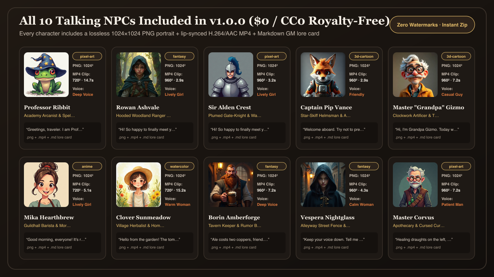
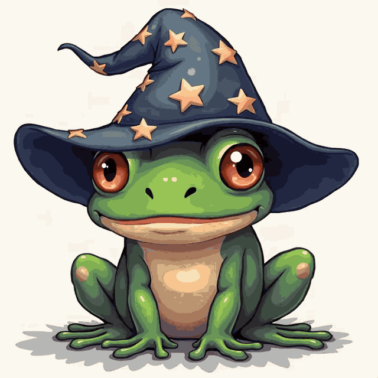

# Free Talking Tavern & RPG NPC Asset Pack (CC0 1.0)

A free, public-domain (**CC0 1.0 Universal**) tabletop RPG and indie game asset bundle featuring **10 original fantasy tavern NPCs**—each with a high-resolution `1024×1024` portrait, a watermark-free lip-synced talking MP4 clip, and a ready-to-run Markdown GM character card.

Built for **D&D 5e, Pathfinder, Foundry VTT, Roll20, Owlbear Rodeo, SillyTavern, Ren'Py, Godot, Unity, and RPG Maker**.

## Live Lip-Sync Preview

---

## One-Click Download (`v1.1.0`)

**[Download `tavern-rpg-npc-pack-cc0-v1.1.zip` (27.84 MB) from GitHub Releases](https://github.com/fourgit/free-talking-tavern-rpg-npc-pack/releases/latest)**

### What's Inside the Archive (32 Files Total)

| Folder / File | Count | Specification |
| --- | :---: | --- |
| `portraits/` | 10 | Lossless `1024×1024` PNG character portraits |
| `talking-clips/` | 10 | Watermark-free lip-synced H.264/AAC MP4 talking clips |
| `npc-cards/` | 11 | 10 individual `.md` GM lore sheets & voice recipes + `NPC-ROSTER.md` |
| `README_LICENSE_CC0.txt` | 1 | Full CC0 1.0 dedication & AI provenance notice |

### Included Characters

1. `01-professor-ribbit` — Professor Ribbit
2. `02-rowan-ashvale` — Rowan Ashvale
3. `03-sir-alden-crest` — Sir Alden Crest
4. `04-captain-pip-vance` — Captain Pip Vance
5. `05-grandpa-gizmo` — Grandpa Gizmo
6. `06-mika-hearthbrew` — Mika Hearthbrew
7. `07-clover-sunmeadow` — Clover Sunmeadow
8. `08-borin-amberforge` — Borin Amberforge
9. `09-vespera-nightglass` — Vespera Nightglass
10. `10-master-corvus` — Master Corvus

---

## License & Transparent AI Disclosure

- **Pure CC0 1.0 Universal (Public Domain Dedication):** You may copy, modify, distribute, and use these assets for personal or commercial projects with no attribution required and no additional restrictions. See [`LICENSE`](./LICENSE).
- **AI-Generated Media Disclosure:** All 10 character portraits, lip-synced MP4 talking clips, and synthetic voice tracks in this pack are original fictional creations generated through an AI text-to-character pipeline. No real human portraits, no real-person likenesses, no face swaps, no cloned voices, and no third-party copyrighted materials were used.

---

## Companion Open-Source Ecosystem

Pair this CC0 asset pack with our open-source tabletop and agent integrations:

- **[fourgit/avatarsay-foundry-vtt](https://github.com/fourgit/avatarsay-foundry-vtt)** *(MIT)* — Foundry VTT module (v11–v13) with a 0-credit offline NPC roller and direct Actor import.
- **[fourgit/avatarsay-sillytavern](https://github.com/fourgit/avatarsay-sillytavern)** *(MIT)* — SillyTavern extension for Character Card V2 import, portraits, and talking clips.
- **[fourgit/avatarsay-mcp](https://github.com/fourgit/avatarsay-mcp)** — Official Model Context Protocol (MCP) server for generating original fictional talking characters from AI agents.

---

## Create Custom Talking NPCs

Need custom dialogue lines, new party members, or additional art styles (fantasy, anime, 3D cartoon, pixel art, watercolor)?

- Try the free **[Fantasy NPC Generator](https://avatarsay.com/fantasy-npc-generator?ref=github-cc0-pack&utm_medium=asset_pack&utm_campaign=cc0-tavern)** to create original fictional talking RPG NPCs from text.
- Explore more character tools at **[AvatarSay](https://avatarsay.com/?ref=github-cc0-pack&utm_medium=asset_pack&utm_campaign=cc0-tavern)**.
